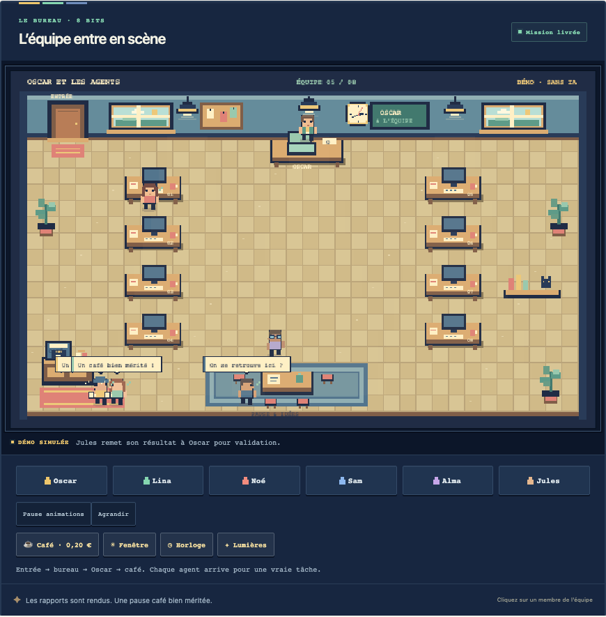

# Oscar et les agents

Donnez une mission à Oscar. Il recrute les bons spécialistes, ils arrivent dans un bureau en pixel art, travaillent, rendent leurs dossiers… et prennent un café quand leur travail est validé.

Une application locale en français, avec **ChatGPT via Codex** ou **Claude Code**, sans clé API à saisir.



## Installer et ouvrir

Dans **Codex/ChatGPT** ou **Claude Code**, vous pouvez simplement demander :

> Installe et lance Oscar et les agents : https://github.com/renaud-bxl/oscar-et-les-agents

L’agent trouve les instructions du dépôt et prépare le bon moteur.

Sur **macOS ou Linux**, vous pouvez aussi coller cette commande dans un terminal :

```sh
curl -fsSL https://raw.githubusercontent.com/renaud-bxl/oscar-et-les-agents/main/install.sh | sh
```

L’installation vous demande votre moteur : **ChatGPT**, **Claude** ou **les deux**. Elle prépare les outils manquants dans le dossier de l’application, ouvre la connexion officielle dans le navigateur si nécessaire, puis ouvre le bureau. Une connexion d’abonnement déjà présente est conservée. Les identifiants restent gérés par les outils officiels.

Pour choisir directement :

```sh
# ChatGPT / Codex
curl -fsSL https://raw.githubusercontent.com/renaud-bxl/oscar-et-les-agents/main/install.sh | sh -s -- --engine codex

# Claude Code
curl -fsSL https://raw.githubusercontent.com/renaud-bxl/oscar-et-les-agents/main/install.sh | sh -s -- --engine claude

# Les deux
curl -fsSL https://raw.githubusercontent.com/renaud-bxl/oscar-et-les-agents/main/install.sh | sh -s -- --engine both
```

Node.js 22.18 ou plus récent est nécessaire ; s’il manque, l’installateur prépare une version portable de Node.js 24 depuis le site officiel. Il ne demande pas de droits administrateur et ne remplace pas vos outils globaux. Le bootstrap automatique vise macOS et Linux ; Windows n’est pas encore validé.

Les fois suivantes, ouvrez **Oscar et les agents** dans votre dossier Applications sur Mac, ou double-cliquez sur **Lancer.command**. Le bureau est disponible sur **http://localhost:4850**. Le lanceur retrouve un bureau déjà ouvert.

## Une équipe qui travaille vraiment

- **Oscar** : prépare le plan, recrute, contrôle, demande les corrections et assemble la livraison.
- **Lina — recherche** : sources, concurrents, marché et informations vérifiables.
- **Noé — rédaction** : articles, messages, scripts et documents.
- **Sam — code** : pages web, scripts et outils.
- **Alma — design** : structure visuelle, HTML/CSS/SVG et lisibilité.
- **Jules — analyse** : données, calculs, comparaisons et recommandations étayées.

Chaque tâche démarre un agent distinct. Oscar choisit les métiers nécessaires ; il n’appelle pas automatiquement les cinq pour une petite demande. Les animations montrent les états réels des tâches. Les pauses et les discussions sont décoratives ; elles ne retardent pas les appels aux modèles.

Un résultat refusé repasse une fois en correction. Les fichiers obligatoires sont contrôlés sur le disque. L’assemblage final est ensuite relu. Un refus persistant reste **à revoir** et n’est pas annoncé comme une livraison validée. Ces contrôles IA et matériels complètent votre relecture ; ils ne garantissent pas l’absence d’erreur.

## Quatorze missions pour démarrer

Réseaux sociaux, site internet, analyse de concurrents, stratégie de contenu, newsletter, lancement de produit, identité visuelle, dossier de présentation, analyse de données, automatisation, article SEO, préparation de réunion, plan commercial et script de podcast.

Choisissez une carte, répondez à quelques questions, ajustez le brief récapitulatif, puis confiez-le à Oscar. Les missions de réseaux sociaux préparent des contenus et des calendriers ; elles ne publient ni n’envoient de messages automatiquement.

## Jusqu’à quatre bureaux en même temps

Pendant une mission, **Créer une autre mission** ouvre une nouvelle fenêtre avec son propre Oscar, son bureau et son équipe. Jusqu’à quatre missions peuvent avancer simultanément. Chaque bureau conserve son lien et ses fichiers ; arrêter une mission n’arrête pas les autres.

Deux spécialistes au maximum travaillent en parallèle dans chaque mission. L’utilisation des modèles reste soumise aux quotas et limites de vos abonnements.

## Tout retrouver dans Documents

Dès l’ouverture, l’application crée :

```text
Documents/
└── Oscar et les agents/
    ├── preferences.json
    └── missions/
        └── identifiant-de-mission/
            ├── state.json
            └── travail/
                ├── Livraison.md
                ├── Livraison/
                ├── Rapports/
                └── dossiers-des-spécialistes/
```

Les briefs, le journal d’activité, les validations et les fichiers restent dans ce dossier. **Mes missions dans Documents** l’ouvre depuis le menu. Arrêter un agent conserve les fichiers déjà produits.

## Un bureau avec de la vie

Les agents entrent par la porte, marchent jusqu’à leur bureau, apportent leurs dossiers à Oscar puis vont au café après validation. Ils discutent et réagissent quand vous cliquez sur eux. Vous pouvez aussi changer l’ambiance par la fenêtre, jouer avec l’horloge, allumer les lampes, réveiller le chat et faire tourner la machine à café. Les animations peuvent être mises en pause ; les missions continuent.

**Essayer la démonstration** montre ce parcours sans appeler un modèle. Le bandeau précise qu’il s’agit d’une simulation.

La machine à café propose un soutien volontaire de **0,20 €** à Renaud via PayPal. Le montant et le destinataire sont visibles avant de quitter l’application. Le paiement se confirme uniquement sur PayPal et ne débloque aucune fonction.

## Connexion et fonctionnement

Le logiciel pilote les programmes officiels déjà connectés sur votre ordinateur. Il ne demande pas de clé API et ne lit, ne copie ni ne publie vos fichiers d’identifiants. Il n’utilise pas une connexion web ChatGPT ou Claude en arrière-plan.

- [Connexion Codex avec ChatGPT](https://learn.chatgpt.com/docs/auth) : le programme officiel ouvre le navigateur.
- [Claude Code](https://code.claude.com/docs/en/cli-reference) : version **2.1.248 ou plus récente** pour le mode restreint.

Le bouton de connexion dans le bureau permet de renouveler une connexion dans le navigateur. Un état « connecté » enregistré ne garantit pas qu’un abonnement ou jeton n’a pas expiré ; une erreur réelle est affichée explicitement et n’est jamais remplacée par une fausse réponse.

Les modèles restent ceux configurés par défaut dans vos outils. Codex garde son bac à sable et refuse les escalades automatiques. Claude conserve son mode restreint et une liste d’outils explicite ; cet adaptateur n’exécute pas de commandes pour Claude. Ses rapports doivent préciser les tests non exécutés.

## Utilisation depuis un client MCP local

L’application autonome est l’interface principale. `mcp.mjs` expose aussi les outils d’état, de lancement, de lecture, d’arrêt et de lecture des livrables. Le serveur du bureau doit être ouvert.

```json
{
  "mcpServers": {
    "oscar-et-les-agents": {
      "command": "node",
      "args": ["/chemin/vers/oscar-et-les-agents/mcp.mjs"]
    }
  }
}
```

L’adaptateur n’est pas ajouté automatiquement à vos comptes. Les conversations web exigent une intégration distante et authentifiée ; ce logiciel local n’expose aucun serveur sur Internet.

## Développer

```sh
git clone https://github.com/renaud-bxl/oscar-et-les-agents.git
cd oscar-et-les-agents
npm start
```

Aucune dépendance de l’interface ou du serveur n’est à installer. Les programmes officiels Codex et Claude Code sont nécessaires pour les vraies missions.

- `npm test` : orchestration, refus de livrables absents, corrections, missions parallèles, arrêt, adaptateurs, connexion et installateur simulé.
- `npm run serve` : serveur sans ouverture automatique.
- `npm run mcp` : adaptateur MCP stdio.
- `node scripts/install.mjs --engine both --dry-run` : vérifier le parcours d’installation sans rien installer.

`PORT` change le port. `OSCAR_DATA_DIR` (ou l’ancien `ATELIER_DATA_DIR`) change le dossier des données. `ATELIER_URL` indique au client MCP une autre URL HTTP locale. Les moteurs privés de l’application se trouvent dans `.tools/` et le runtime portable dans `.runtime/` ; ces dossiers ne sont pas versionnés.

Le serveur écoute uniquement sur 127.0.0.1, vérifie les origines, refuse les chemins de fichiers hors mission et sert les livrables comme téléchargements.

## Création

[Créé par Renaud](https://www.facebook.com/renaud.brussels).

Inspiré du principe du [Bureau des agents](https://github.com/devlikemasta/bureau-des-agents). Le code, l’orchestration et les dessins de cette application sont une réalisation distincte ; aucune voix, musique ou image du projet de référence n’est reprise.

Licence MIT.
